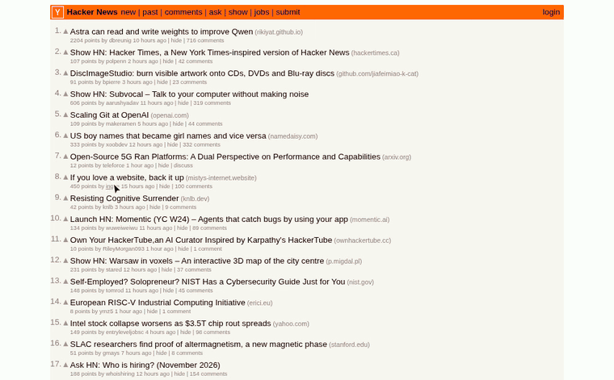
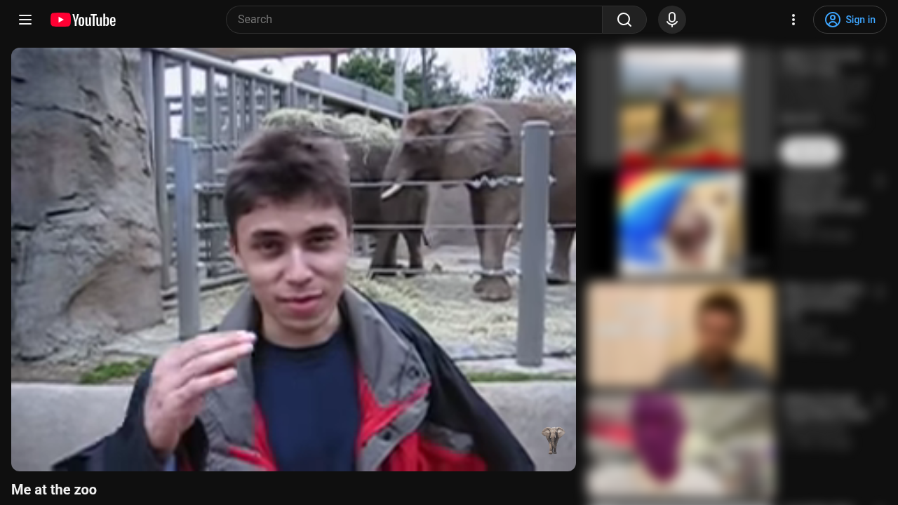
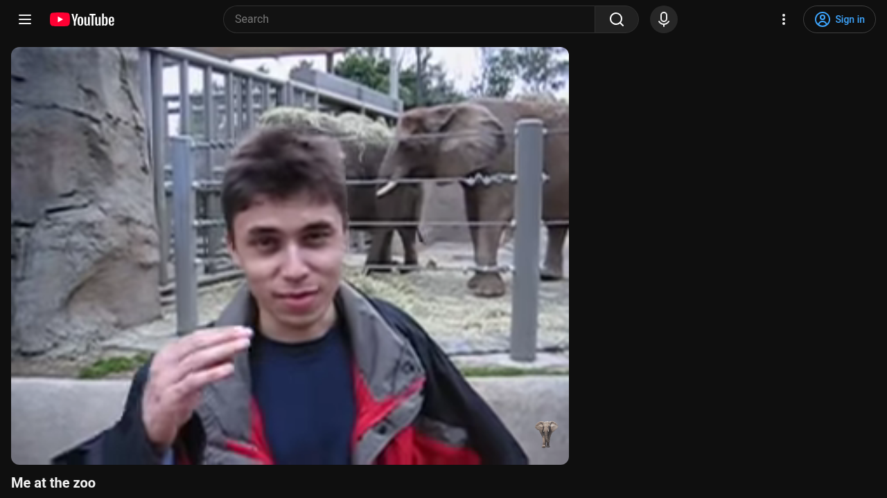
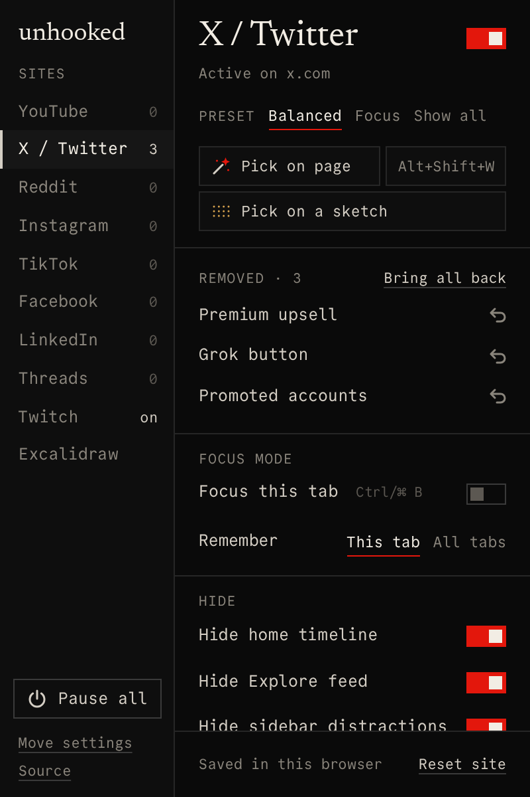
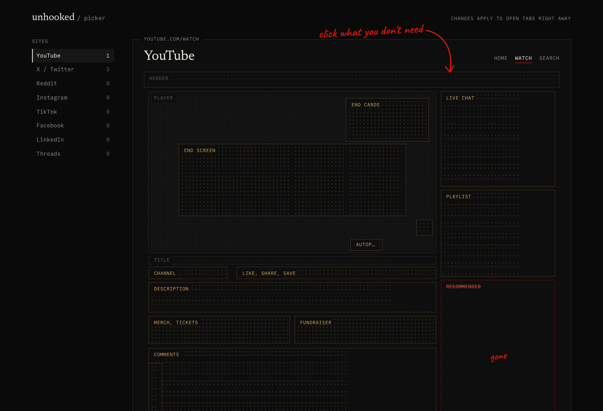
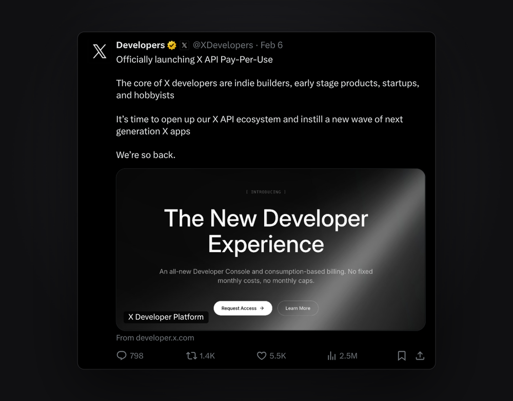
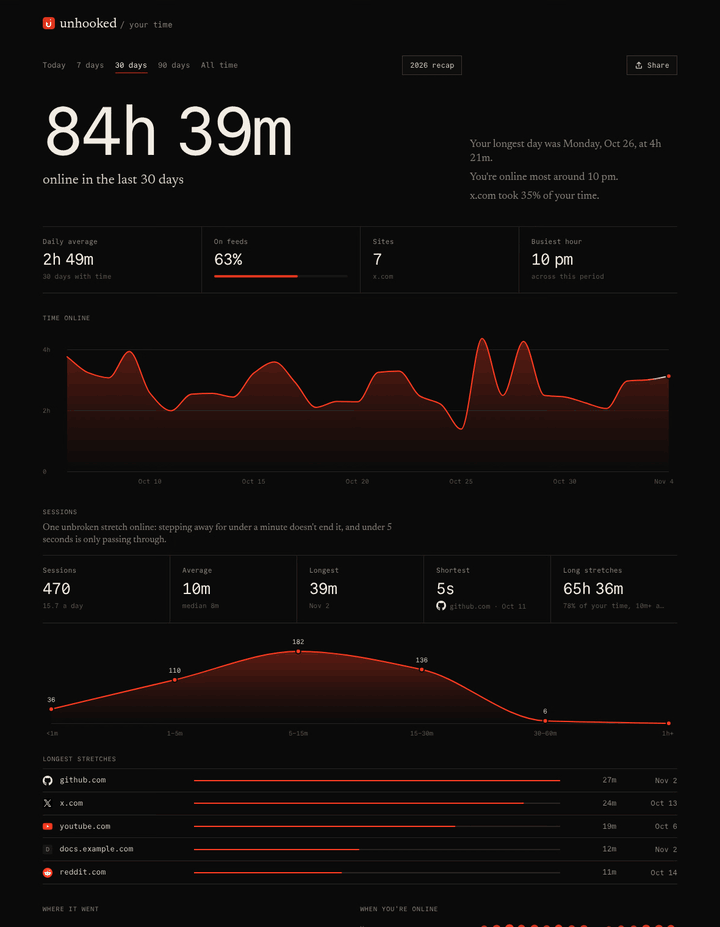
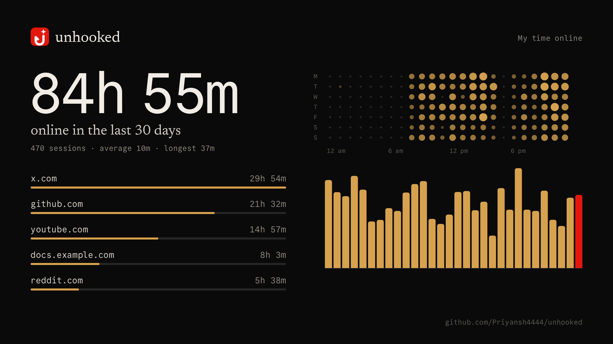
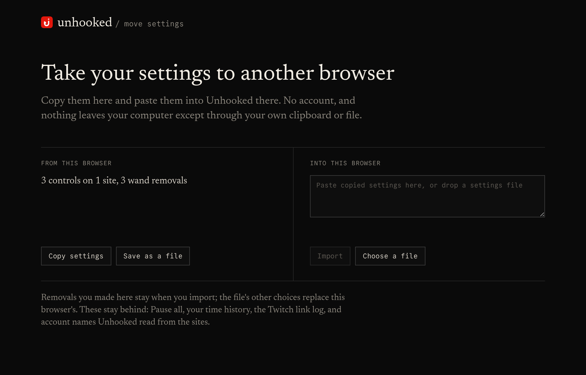

<p align="center"></p>

# Unhooked

Take the hooks out of the sites you use. Unhooked hides feeds and recommendations on **YouTube, X / Twitter, Reddit, Instagram, TikTok, Facebook, LinkedIn and Threads**, leaves just the canvas on **Excalidraw**, turns links in **Twitch chat** into compact pills with previews, and has a **film mode** for clean screenshots. It runs on Chrome (and other Chromium browsers) and Firefox. There's no account, and your settings stay in your browser.



**A magic wand for any part of any site.** Point, and a red box shows what a click would remove. It stays removed, and you can bring it back from the popup.

| Before | After the Balanced preset |
| :-: | :-: |
|  |  |

| Every site's choices in one popup | Or click parts of a sketch of the page |
| :-: | :-: |
|  |  |

Unhooked is the successor to [Dissatisfied](https://github.com/Priyansh4444/Dissatisfied): its Twitch link pills live here now, next to Unhooked's per-site controls, and what its focus modes did is now those switches. It started as a fork of [Havockeyan/UnhookYoutube-opensource](https://github.com/Havockeyan/UnhookYoutube-opensource) (MIT), an independent Unhook-style extension. It is **not** the commercial Unhook extension and is not affiliated with Unhook or any site it supports.

## Install

```sh
bun install
bun run build:chrome     # → dist/
bun run build:firefox    # → dist-firefox/
```

- **Chrome, Brave, Edge:** open `chrome://extensions`, turn on **Developer mode**, choose **Load unpacked** and select `dist/`.
- **Firefox:** open `about:debugging#/runtime/this-firefox`, choose **Load Temporary Add-on** and select any file in `dist-firefox/`.
- **Safari** builds (`bun run build:safari`) but has not been tested.

`bun run package` writes release ZIPs for every browser to `dist/unhooked-<browser>-<version>.zip`.

## Using it

Click the toolbar icon. The popup opens on the site of your current tab; the list on the left shows every site and how many of its controls are on.

**Hide controls** (the eight feed sites). Every control starts off.

- **Balanced** hides each site's feeds and recommendations, leaving stories and Reels controls off. On YouTube it hides Home, related videos, Shorts and end-screen suggestions, and turns autoplay off.
- **Hide all** turns every control on; **Show all** turns them all off. The underlined preset is the one matching your current choices.
- The switch beside the site's name turns Unhooked off there without forgetting your choices, and **Alt+Shift+S** flips it for the site you're on. **Reset site** puts the site back as it was: every control off, feeds no longer skipped, wand removals gone. **Undo** appears next to it in case that was too much.
- **Pick on page** is a magic wand for anything the controls don't cover. Point at the page: a red box shows exactly what a click would remove, with how many elements like it are on the page. Click to hide it; it stays hidden on that site from then on. **↑**/**↓** widen to the surrounding part or narrow back, **S** switches between this one and every element like it, **Z** undoes, **Esc** finishes. What you removed is listed first in the popup: click a name to rename it, the arrow to bring that one back, or **Bring all back** for the lot (each with an **Undo**). The wand also has a keyboard shortcut, **Alt+Shift+E** (⌥⇧E on a Mac) unless you change it: click the shortcut next to the wand button, press the keys you want (holding Ctrl, Alt or ⌘, so it can't fire while you type), or Backspace to turn it off. Press it on a supported site to start the wand, and again to stop.
- **Skip the feeds** is the stronger option: instead of hiding a feed, leave it before it loads, for a page you choose. Each site offers a few of its own pages (YouTube's Subscriptions or Watch later, X's Notifications or Bookmarks, Instagram's Messages or your Saved posts, …), or **Other** for any path on the site. On YouTube, Shorts also open in the normal player. Pause all stops it like everything else.
- **Sketch** opens the picker: a dot-matrix sketch of the site's pages (YouTube's Home, Watch and Search, X's Home and Explore, and so on). Click a part to hide it on the real site, and click it again to bring it back. Dim parts, such as navigation and the video player, always stay. The picker and the switches change the same settings, so either one shows what the other did.
- **Any other website** gets its own entry at the bottom of the site list while it's open in the tab, so the wand works there too. The first time you pick on a site, the browser asks to let Unhooked run there (only that site), so what you remove stays removed on later visits. **Forget site** removes them and gives the access back.
- **Hovering a switch shows it on the page.** In the popup or the picker, hovering any switch that changes the page outlines what it covers in the open site tab, the same way the wand does: single controls, groups such as YouTube's "Hide video sidebar", the site's main switch, **Focus this tab** and X's focus options, and wand removals. The popup's footer explains what the hovered control does.

**X also has Layout switches:** **Center timeline** (with a width) and **Custom text size**. **YouTube** has **Fill the window in theater**: press T and the player takes the whole window, with the header back when you point at the top edge. **Excalidraw's** site switch leaves just the canvas.

**Film mode** is for making something of what you find. Press **Film mode** in the popup, or **Alt+Shift+F**. **S** saves a clean screenshot of the window to your downloads, and copies it where the browser allows. On X, click a post and it moves to the center of the screen, slightly rounded, on a dark backdrop. It's real page elements rather than a picture: the text is redrawn at the larger size and images load at full resolution, and the toolbar and pointer leave the frame after a moment, so you can screen-record it as it is. The film button in each post's row of actions does the same in one click, and leaving the post then leaves film mode (turn the button off under Layout). **S** saves just the post and its backdrop, and **A** shows or hides its buttons. **Esc** goes back to the page, then out of film mode.



**Your time** (under Pause all) shows where your time on the web goes, for today, 7, 30 or 90 days, or all time: the total and how it compares with the period before, time per day, a ranking of sites, and a dot matrix of when you're online. Click a site to see just that site. **Sessions** show how you use a site as well as how long: how many, the average, the longest and shortest, and how much of your time came in focused stretches of ten minutes or more. A session is one unbroken stretch, on a site or online overall: stepping away for under a minute doesn't end it, and under five seconds is only passing through. It counts the site in front while you're using it, including while a video plays, and leaves out private windows and anything you tell it to forget. It stops counting the moment you step away: when the browser reports idle a minute later, that minute is taken back, and time the computer slept through never counts. **Share** turns the view into a sharp 16:9 card: save it, copy it, or **Post on X**, which copies the picture and opens a post with the words ready. Site names can be left off the card.





**Twitch chat links** become pills with a short label (`YT · Me at the zoo`, `owner/repo`, `@user`), and hovering one opens a preview card. The popup can turn pills off, set the hover delay, and show the last 25 links posted in chat; that log stays on your device and can be cleared.

**Pause all** (bottom left) stops everything the extension does to pages, on every site, until you press **Resume**. Your choices are kept.

**Move settings** (under it) takes your choices to another browser, any mix of Chrome, Helium, Brave, Edge and Firefox. Press **Copy settings** here and paste them into the same page there, or save a file and drop it in. Importing shows what's in the file first, keeps removals you made in that browser, can be undone, and asks for access to any sites outside Unhooked's list that have removals. Pause all, your time history, the Twitch link log and account names stay behind. Files are checked on the way in: anything Unhooked doesn't recognise is ignored.



## Supported controls

| Site        | Controls                                                                                                                                                                                                                                                                  | Feed hiding applies on                                          |
| ----------- | ------------------------------------------------------------------------------------------------------------------------------------------------------------------------------------------------------------------------------------------------------------------------- | --------------------------------------------------------------- |
| YouTube     | Home, related sidebar, live chat, playlists, fundraiser, end-screen feed and cards, Shorts, comments and avatars, mixes, merch/tickets/offers, video buttons, channel row, description, notifications, unrelated search shelves, Explore/subscriptions/service links, autoplay, annotations | Desktop, mobile, and embedded players on any site |
| X / Twitter | Home timeline and its "new posts" pill, Explore, the sidebar's news, trends, live events, scores and suggestions (only search stays), the whole sidebar, Grok, the chat button, the navigation                                                                                                                                                                | `/home`; Explore and its tabs; sidebar everywhere but search and posts |
| Reddit      | Home, Popular and All feeds, recommendation panels                                                                                                                                                                                                                        | `/`, `/r/popular`, `/r/all` and their sort tabs; panels everywhere |
| Instagram   | Home posts, Explore grid, suggestions sidebar, stories tray, Reels feed, Reels & Explore links, the whole navigation                                                                                                                                                    | `/`; Explore; the Reels tab (`/reels/…`); links everywhere      |
| TikTok      | For You and Following, Explore, suggested accounts, Live directory                                                                                                                                                                                                       | `/`, `/foryou`, `/following`; Explore; Live; suggestions everywhere |
| Facebook    | Home feed, right sidebar, stories tray, Reels viewer                                                                                                                                                                                                                     | `/`, `/home.php`; `/reel`, `/reels`                             |
| LinkedIn    | Home feed, news and recommendations                                                                                                                                                                                                                                       | `/`, `/feed`                                                    |
| Threads     | For You and Following, suggested accounts                                                                                                                                                                                                                                 | `/`, `/following`, `/for_you`                                   |

Profiles, direct posts and videos (including shared `/reel/…` links), search, messages, communities and job pages always stay visible, and so does any page the extension doesn't recognise. Hiding is CSS only: newly loaded posts are covered, nothing is removed from the page, and turning a control off restores it immediately.

## Privacy and permissions

Settings, your time history and the Twitch link log live in your browser's local extension storage. There is no account, server or analytics.

- **Hide controls and film mode** never touch the network. Screenshots stay on your computer.
- **Your time** stores which sites you spent time on, by the hour, for up to 400 days. Never the pages or addresses within a site. It stays on this computer, isn't part of **Move settings**, and only leaves if you share a card yourself. Turn it off or erase it on its page.
- **Twitch link pills** look up links that appear in chat, while pills are on: oEmbed endpoints on youtube.com, reddit.com, vimeo.com, open.spotify.com and publish.x.com, the GitHub API, and pages on github.com, imgur.com and lakebed.app. Thumbnails load from i.ytimg.com, and playing a YouTube preview loads youtube-nocookie.com's player. Nothing is sent to us. Turn pills off to stop these lookups.

Permissions: `storage` for settings; `tabs` for opening the popup on your current site and for knowing which site is in front; `alarms` and `idle` for counting your time, and stopping when you step away; `activeTab` for film mode, to take screenshots of a tab where you started it; `scripting` to start the wand when you press **Pick on page** (and, on a site outside the list, to keep its removals applied), and to start film mode. Wand removals are CSS selectors stored with your other settings. Host access covers exactly the supported sites and the Twitch lookup hosts above. Any other site is optional access the browser asks you for, one site at a time, when you use the wand there.

Settings are independent keys (`unhooked.site.x.hideHomeFeed`, for example), so changing one site never overwrites another. Saved options from the original YouTube extension (`unhookedOptions`) are still read; anything you change here takes precedence.

## Development

Requires [Bun](https://bun.sh).

```sh
bun run dev           # unminified Chrome build in dist/, rebuilt on every change
bun run check         # typecheck, lint, format
bun test              # unit tests
bun run e2e chrome    # end-to-end suites (CHROME_PATH=…; see CONTRIBUTING.md)
bun run e2e firefox   # the same suites in Firefox (FIREFOX_PATH=…)
bun scripts/live-login.ts && bun e2e/live.mjs   # every control against the real, signed-in sites
bun scripts/attach.ts serve                     # or inspect the sites in your own browser (CONTRIBUTING.md)
bun scripts/screenshots.ts                      # regenerate the images in this README
```

End-to-end tests load the real extension into a browser. Suites against stubbed pages (`smoke`, `social`, `youtube-controls`, `popup`, `transfer`, `picker`, `twitter`, `twitch`) need no network; `youtube*`, `excalidraw` and `twitch-cards` use the live sites, deliberately, because markup changes there are what break the extension. **Stubbed pages are not signed-in coverage:** Instagram, Facebook, LinkedIn, Threads and signed-in X layouts need checking by hand before claiming complete live support. If a layout changes and something stays visible, pause the site and report the URL and the element's selector.

The code map, how a site is added, and how the parts talk to each other are in [CONTRIBUTING.md](CONTRIBUTING.md); packaging for the stores is in [docs/PUBLISHING.md](docs/PUBLISHING.md).

## License

[MIT](LICENSE). Upstream copyright is retained. Code from Dissatisfied was released into the public domain by its author.
