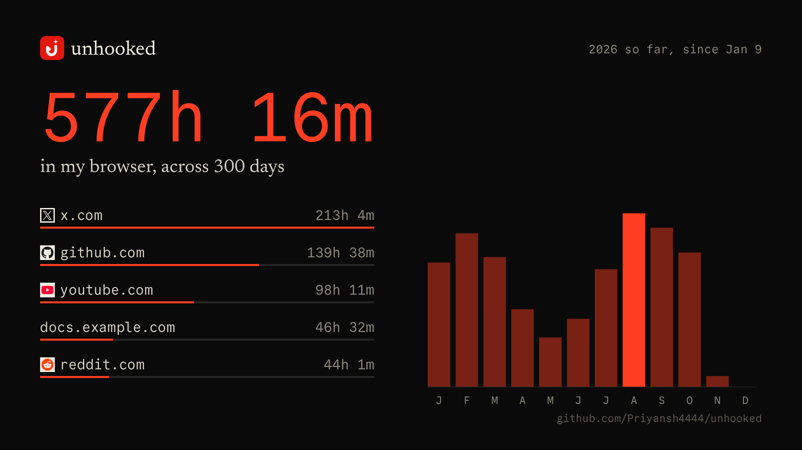

<p align="center"></p>

<h1 align="center">Unhooked</h1>

<p align="center"><b>Take the hooks out of the sites you use.</b><br>
Hide feeds, remove anything with a magic wand, and see where your time really goes.<br>
No account. Nothing leaves your computer.<br>
<a href="https://unhooked.pronsh.dev">unhooked.pronsh.dev</a></p>

<p align="center">YouTube · X · Reddit · Instagram · TikTok · Facebook · LinkedIn · Threads · Twitch · Excalidraw · any other site with the wand<br>
Chrome, Brave, Edge, Helium and other Chromium browsers, and Firefox</p>


## What it does

| | |
| :-- | :-- |
| **Hide the feed** | One switch per thing: home feeds, Shorts, trends, suggestions, comments, sidebars. **Balanced** does the sensible set for a site in one click. |
| **Magic wand** | Point at anything on any site. A red box shows what a click would remove, and it stays removed across reloads and sessions until you bring it back, which Inspect Element can't do. |
| **Skip the feeds** | Leave a feed before it loads, for a page you choose: your subscriptions, your saved posts, anywhere. |
| **Your time** | Where your time on the web goes, by site, day and hour, with sessions and a recap of your year. Share it as a card. |
| **Film mode** | Clean screenshots to your clipboard, and on X a post framed at the center of the screen, ready to record. |
| **Twitch link pills** | Links in chat become short pills with previews. |
| **Move settings** | Copy your choices to any other browser. |

| Before | After the Balanced preset |
| :-: | :-: |
|  |  |

## Install

It isn't in the stores yet, so you build it once and load it:

```sh
bun install
bun run build:chrome     # → dist/
bun run build:firefox    # → dist-firefox/
```

- **Chromium browsers:** open `chrome://extensions`, turn on **Developer mode**, choose **Load unpacked**, and pick `dist/`.
- **Firefox:** open `about:debugging#/runtime/this-firefox`, choose **Load Temporary Add-on**, and pick any file in `dist-firefox/`.

After rebuilding, press **Reload** on the extension. Pages update from disk by themselves, but the part running in the background doesn't until you do.

## Using it

Click the toolbar icon. The popup opens on the site you're on, with every site listed down the side.


- **Presets:** **Balanced** hides feeds and recommendations, **Hide all** turns everything on, **Show all** turns everything off.
- **The switch beside a site's name** turns Unhooked off there without forgetting your choices.
- **Hover any switch** to see what it covers, outlined on the page.
- **Pause all** stops everything on every site until you resume.
- **Reset site** puts a site back as it was. **Undo** appears in case that was too much.

### Shortcuts

All under your left hand, and the letter says what it does. Change them at `chrome://extensions/shortcuts`.

| Keys | Does | |
| :-- | :-- | :-- |
| `Alt+Shift+S` | Turn Unhooked on or off for this site | **S**witch |
| `Alt+Shift+E` | Start the wand (change this one in the popup) | **E**rase |
| `Alt+Shift+F` | Start film mode | **F**ilm |
| `` ` `` | On a YouTube video: fill the window, and again or `Esc` to go back. It stays on for that tab, and `T` steps out of it. There's a button for it beside the theater button. | |

### The magic wand

Press **Pick on page**. Point, and click to remove. `↑`/`↓` widen to the surrounding part or narrow back, `S` switches between this one and every element like it, `Z` undoes, `Esc` finishes.

What you removed is listed first in the popup: click a name to rename it, the arrow to bring it back, or **Bring all back** for the lot.

On a site Unhooked doesn't list, it appears at the bottom of the popup's list while you're there. The first time you use the wand on it, the browser asks for access to that one site. **Forget site** removes everything and gives the access back.

If you'd rather not touch the real page, **Sketch** opens a dot-matrix drawing of a site's pages to click on instead.


### Your time

Open it from **Your time** in the popup. Pick a period, or click a site to see just that one.


- **What counts:** the site in front while you're using it, or while it's playing sound. Not private windows, not while another app has the focus, and not once you've stepped away: after three minutes with no input and nothing playing, those three minutes are taken back. Time the computer slept through never counts.
- **Sessions:** one unbroken stretch, on a site or online overall. Stepping away for under a minute doesn't end one, and under five seconds is only passing through. You get the count, average, median, longest and shortest, and each site's longest stretch, with its icon.
- **Long stretches:** time spent ten minutes or more at a time.
- **Recap:** your year in a few screens, from the button at the top: the total, where it went, your biggest month and day, and your longest stretch, ending in a card to share. History is kept for 400 days, so an older year says when its numbers start.
- **It doesn't depend on hiding anything.** It's a record of where your time goes on the web, so Pause all and a site's switch don't affect it. It has its own switch on that page.
- **Share** makes a sharp 16:9 card to save, copy, or **Post on X**, which copies the picture and opens a post with the words ready. Site names and icons can be left off.




History stays on this computer for up to 400 days, and isn't part of Move settings. You can turn it off, forget a site, or erase it all on that page.

### Film mode

Press **Film mode** in the popup, or `Alt+Shift+F`. `S` copies a clean picture of the window to your clipboard, and `Shift+S` saves it as a file instead.

On X, every post has a film button just left of Share (turn it off under **Layout**). Click it and the post flies to the center of the screen, slightly rounded, on a dark backdrop. It's a real post rather than a picture: its text is selectable, links open in a new tab, and Like and Bookmark work. Reply, Repost and Share close the frame and open X's own box. The pointer leaves the frame after a moment, so you can screen-record it directly. `S` copies the post and its backdrop, `A` shows or hides its buttons, and `Esc` or a click on the backdrop goes back. The bar at the bottom only stays a moment; moving the pointer to the bottom of the window or pressing a key brings it back.


A browser only lets an extension capture a tab with access to all sites, or just after you've used its toolbar button or shortcut on that tab. So the first time you take a picture without having done that, a small window asks. Saying no costs nothing but the picture.

### Moving to another browser

**Move settings** copies your choices as text or a file. Paste or drop them into the same page in the other browser. It shows what's in the file first, keeps removals you made there, can be undone, and ignores anything it doesn't recognise.

## Supported sites

| Site | What you can hide |
| :-- | :-- |
| **YouTube** | Home, recommendations (the video takes their width), Shorts, comments, end screens, live chat, playlists, mixes, merch, video buttons, channel row, description, notifications, Explore and subscriptions links, autoplay, annotations. Plus **Fill the window**: the video takes the whole window without going full screen, on `` ` `` or a button in the player for one tab, or a switch for all of them. |
| **X / Twitter** | Home timeline and its "new posts" pill, Explore, sidebar news and trends, the whole sidebar, Grok, the chat button, navigation. Plus **Center timeline** and **Custom text size**. |
| **Reddit** | Home, Popular and All feeds and their sort bar, recommendation panels, the left sidebar |
| **Instagram** | Home posts, Explore grid, suggestions, stories, Reels, Reels and Explore links, navigation |
| **TikTok** | For You and Following, Explore, suggested accounts, Live |
| **Facebook** | Home feed, right sidebar, stories, Reels |
| **LinkedIn** | Home feed, news and recommendations |
| **Threads** | For You and Following, suggested accounts |
| **Excalidraw** | The site's switch leaves just the canvas |
| **Twitch** | Link pills in chat, with a hover preview and a log of the last 25 links. Cards read like Discord embeds, with each site's icon. X posts preview in full, with their pictures, video and quoted post. Profiles show their name and bio. Spaces, lists and communities only say what they are, because X doesn't publish them. |

**Balanced** only includes what has been seen working on the live site. Facebook, TikTok's suggested accounts and Threads' suggested accounts haven't been, so they're off until you turn them on. Reddit and Threads were checked signed out.

Profiles, direct posts and videos, search, messages, communities and job pages always stay visible, and so does any page it doesn't recognise. Hiding is CSS only, so nothing is removed from the page and turning a control off restores it at once.

## Lightweight by design

It does nothing on sites it has no business on, and very little on the rest. Measured on the production build, against no extension:

| | Cost |
| :-- | :-- |
| An unrelated site | Nothing: none of its code runs there |
| YouTube on Balanced | No measurable change in style work |
| A busy timeline, all controls on | About 0.6% of the time, in script |
| Scripts on X | 3 ms at load, 0.8 MB of memory |
| In the background | 1 MB while awake, and asleep whenever nothing is being counted |

The numbers, and how to reproduce them, are in [docs/PERFORMANCE.md](docs/PERFORMANCE.md).

## Privacy and permissions

There is no account, server or analytics. Your settings and history stay in your browser.

Network use comes from one feature: **Twitch link pills** look up links that appear in chat, while pills are on (oEmbed endpoints on youtube.com, reddit.com, vimeo.com, open.spotify.com and publish.x.com, X's embed service on cdn.syndication.twimg.com, the GitHub API, and pages on x.com, github.com, imgur.com and lakebed.app; pictures load from i.ytimg.com and pbs.twimg.com, and each link's site icon from icons.duckduckgo.com, which gets the domain and nothing else, and playing a preview loads youtube-nocookie.com's player or a video from video.twimg.com). Nothing is sent to us. Turn pills off to stop them.

| Permission | Why |
| :-- | :-- |
| `storage` | Your choices |
| `tabs` | Opening the popup on your current site, and knowing which site is in front to count time |
| `alarms`, `idle` | Counting time, and stopping when you step away |
| `favicon` | The icons beside sites in **Your time**, from your browser's own cache (Chromium) |
| `activeTab` | Film mode's pictures of a tab where you've just used the extension |
| `scripting` | Starting the wand, film mode and hover previews when you ask |
| Host access | Exactly the listed sites and the Twitch lookup hosts above |
| **Only if you ask:** one site | The wand on a site that isn't listed |
| **Only if you ask:** all sites | Film mode's pictures, the first time you need one that way, or previews of any link in Twitch chat. Previews read a link's page when you point at it, without your accounts, and never on your own network. |

**Your time** records which sites you spent time on, by the hour, and each site's icon. It never records the pages or addresses within a site. It leaves your computer only if you share a card yourself.

## Development

Requires [Bun](https://bun.sh).

```sh
bun run dev           # unminified Chrome build in dist/, rebuilt on every change
bun run check         # typecheck, lint, format
bun test              # unit tests
bun run e2e chrome    # end-to-end suites (CHROME_PATH=…; see CONTRIBUTING.md)
bun run e2e firefox   # the same suites in Firefox (FIREFOX_PATH=…)
bun scripts/perf.ts   # what it costs a page, against no extension
bun scripts/screenshots.ts   # regenerate the images in this README
```

End-to-end tests load the real extension into a browser. Most run against stubbed pages and need no network; `youtube`, `excalidraw` and `twitch-cards` use the live sites deliberately, because markup changes there are what break the extension. Stubbed pages aren't signed-in coverage: if a layout changes and something stays visible, pause the site and report the address and the element.

The code map and how the parts talk to each other are in [CONTRIBUTING.md](CONTRIBUTING.md), and packaging for the stores is in [docs/PUBLISHING.md](docs/PUBLISHING.md).

## Where it came from

Unhooked is the successor to [Dissatisfied](https://github.com/Priyansh4444/Dissatisfied), and started as a fork of [Havockeyan/UnhookYoutube-opensource](https://github.com/Havockeyan/UnhookYoutube-opensource) (MIT). It is **not** the commercial Unhook extension, and isn't affiliated with Unhook or any site it supports.

## License

[MIT](LICENSE). Upstream copyright is retained. Code from Dissatisfied was released into the public domain by its author.
